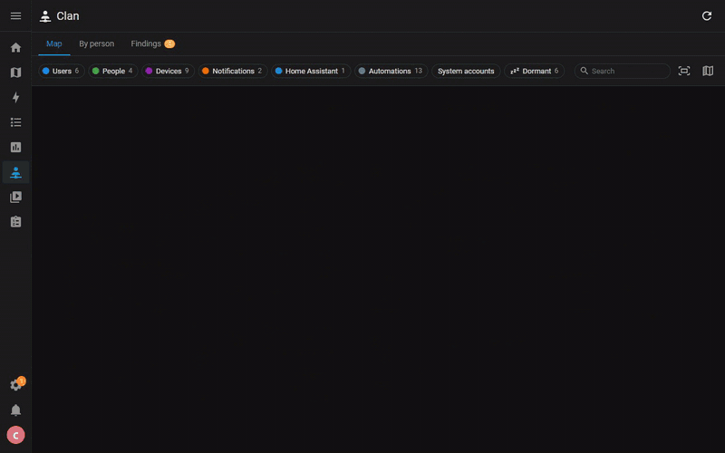

# Clan

[English version](README.md)

Un panneau Home Assistant qui répond, sur un seul écran : qui peut se connecter, qui est suivi, qui reçoit
les notifications.

Clan lit les utilisateurs, les personnes, les enregistrements de l'application compagnon, les services de
notification, les automatisations, scripts et alertes, et dessine leurs liens en colonnes, des comptes aux
automatisations :

- les utilisateurs et leur rôle (propriétaire, administrateur, utilisateur, compte système), leurs moyens de
  connexion, la double authentification, les jetons longue durée et la dernière activité de chacun ;
- la personne de chaque utilisateur, et les traceurs qui donnent sa position ;
- les téléphones, montres et tablettes connectés à l'application compagnon, et par quel utilisateur ;
- chaque automatisation, script ou alerte qui notifie, et l'appareil qu'elle atteint : directement, par un
  groupe de notification, ou par `notify.notify`, qui atteint tous les téléphones ;
- les automatisations qui se servent de la présence de quelqu'un, ou d'un capteur d'un téléphone (prochain
  réveil, charge, Wi-Fi) ;
- ce qu'un téléphone peut lancer par un bouton de notification, comme ouvrir le portail depuis la
  notification de la sonnette ;
- quand chaque téléphone a reçu sa dernière notification, et par quel service ;
- les tableaux de bord que chaque utilisateur peut ouvrir, et les vues réservées à d'autres.

Trois vues :

- Carte : cinq colonnes qui se lisent de gauche à droite, utilisateurs, personnes, appareils,
  notifications et automatisations. Sur un ordinateur, la carte se construit colonne après colonne à
  l'ouverture du panneau, et de nouveau après une actualisation. Un clic sur un nœud éclaire ce à quoi il mène, vers les comptes et vers les
  automatisations, et ouvre son détail. De
  là, ou depuis une fiche de la vue suivante, Isoler ne garde que cette branche sur la carte, et
  Masquer retire le nœud avec tout ce qui ne dépend que de lui : masquer le compte d'un enfant retire sa
  personne et ses téléphones, mais un service qui atteint aussi d'autres téléphones reste. Une personne et
  son compte comptent pour un. Le choix est mémorisé, et une ligne au-dessus de la carte rappelle ce qui est
  isolé ou masqué, avec de quoi revenir en arrière.
  Les éléments en sommeil sont grisés et cerclés de pointillés : un téléphone muet dont l'appli n'a pas été
  mise à jour depuis trois mois, un compte sans connexion depuis trois mois, et ce qui ne joint qu'eux (une
  personne suivie seulement par de vieux téléphones, une automatisation qui ne notifie qu'eux). Le bouton
  En sommeil les met en évidence.
- Par personne : une fiche par utilisateur, avec sa personne, ses traceurs, ses appareils, les
  automatisations qui le notifient, ses tableaux de bord et ses jetons.
- Constats : ce qui mérite un coup d'œil, comme une automatisation qui appelle un service de notification
  disparu, un téléphone enregistré plusieurs fois, une appli muette depuis le démarrage, un téléphone
  probablement abandonné, un compte jamais utilisé, un membre de groupe disparu ou une personne sans compte.

Le panneau est réservé aux administrateurs, puisqu'il montre les comptes et leurs jetons (jamais les jetons
eux-mêmes). L'intégration ne fait que lire : rien n'est modifié dans Home Assistant. Elle garde un petit
fichier à elle, `.storage/clan.memory`, avec le dernier vrai signe de chaque téléphone et depuis quand
un téléphone muet se tait : après un redémarrage, tous les états portent l'heure du démarrage, et la carte
oublierait sinon pendant une heure quels téléphones sont silencieux. Le fichier part avec l'intégration.

## Installation

Home Assistant 2025.1 ou plus récent (éprouvé sur la 2025.1.4 et sur la version courante).

Dans Paramètres > Marketplace, chercher Clan (ou utiliser le bouton ci-dessus) et choisir Installer.
Ajouter ensuite l'intégration Clan depuis Paramètres > Appareils et services : le panneau apparaît dans la
barre latérale, pour les administrateurs.

S'il n'apparaît pas encore, choisir Ajouter grâce à un lien et saisir `https://github.com/jolabs40/clan-ha`
(une connexion à GitHub est demandée).

Avant Home Assistant 2026.11, la Marketplace était l'intégration HACS : y chercher Clan, le télécharger, puis
redémarrer Home Assistant.

Sans l'une ni l'autre, décompresser `clan.zip`, joint à la [dernière version](https://github.com/jolabs40/clan-ha/releases/latest),
dans un dossier `custom_components/clan` de la configuration, redémarrer Home Assistant, puis ajouter
l'intégration.

## Comment les liens sont trouvés

| Lien | Source |
| --- | --- |
| utilisateur et personne | le compte utilisateur de la personne |
| personne et traceurs | les traceurs de la personne |
| utilisateur et téléphone | l'utilisateur connecté dans l'application compagnon lors de son inscription |
| automatisation et téléphone | actions `notify.mobile_app_*`, `notify.send_message` sur des entités de notification, actions `*.notify` d'autres intégrations visant un appareil |
| groupe de notification | membres des groupes de notification YAML et des groupes d'entités de notification |
| `notify.notify` | tous les téléphones qui peuvent recevoir une notification push |
| messageries | `telegram_bot.send_*`, Matrix et les autres actions `*.send_message`, `mastodon.post` : un nœud par intégration |
| présence | entités `person.*` et traceurs cités dans une automatisation |
| capteur de téléphone | entités de l'application compagnon citées dans une automatisation (prochain réveil, batterie, Wi-Fi...) |
| bouton de notification | une notification avec `actions` et l'automatisation ou le script qui attend cette action (déclencheur `mobile_app_notification_action` ou `wait_for_trigger`) |

Les gabarits sont lus quand on peut en tirer une cible (un identifiant d'appareil dans une valeur par défaut,
par exemple). Une notification dont le service est un gabarit (`notify.{{ ... }}`) a son propre nœud, qui dit
qu'on ne sait qui elle atteint qu'au moment de l'envoi.

La dernière notification d'un téléphone vient des appels de notification que Clan voit passer une fois
installé, gardés d'un redémarrage à l'autre, et de l'état de son entité de notification. Avant, le panneau
dit depuis quand il observe. Une vue réservée à certains utilisateurs ne fait que la cacher aux autres dans
l'interface : ce n'est pas une permission.

## Quand Home Assistant change

Pour savoir à quelle intégration appartient un service de notification et ce que font les automatisations,
scripts et alertes, Clan lit quelques structures internes à Home Assistant. À chaque tracé de la carte, il
vérifie qu'elles sont toujours là. Si une version en a déplacé une, un bandeau en haut du panneau indique ce
que la carte ne peut plus montrer, et un avertissement est écrit une fois dans le journal.

## Langues

Anglais et français.
