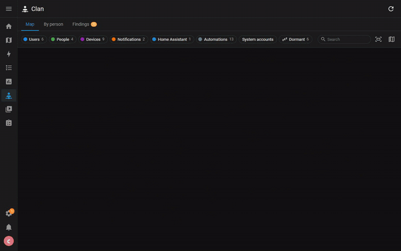

# Clan

A Home Assistant panel that answers, on one screen, who can sign in, who is followed, and who gets notified.

Clan reads the users, people, companion app registrations, notification services, automations, scripts
and alerts of your instance, and draws the links between them as a map, in the manner of the Zigbee network
maps:

- users and their role (owner, administrator, user, system account), sign-in methods, two-factor
  authentication, long-lived tokens, and when each user was last active;
- the person each user signs in as, and the trackers that give that person's location;
- the phones, watches and tablets signed in to the companion app, and by which user;
- every automation, script and alert that sends a notification, and the device it reaches, directly, through
  a notification group, or through `notify.notify`, which reaches every phone;
- the automations that use someone's presence.

The panel has three views:

- Map: a graph in levels around each account, its person and devices first, then what reaches them,
  with the automations that only notify one phone listed beside it and the small unrelated groups set
  aside on the right; or columns from accounts to automations. Click a node to light up what it leads to,
  towards the accounts and towards the automations, and to read its details. From there, or from a card of
  the next view, Isolate keeps only that branch on the map, and Hide takes the node off the map
  with whatever only hangs from it: hiding a child's account removes their person and phones, while a
  service that also reaches other phones stays. A person and its account count as one. The choice is
  remembered, and a row above the map shows what is isolated or hidden, with a way back.
  Dormant items are greyed with a dotted ring: a silent phone whose app has not been updated for three
  months, an account with no sign-in for three months, and what only reaches them (a person followed only
  by old phones, an automation that only notifies them). The Dormant button highlights them.
- By person: one card per user with their person, trackers, devices, the automations that notify them
  and their tokens.
- Findings: what deserves a look, such as an automation calling a notification service that no longer
  exists, a phone registered several times, an app silent since Home Assistant started, a phone probably
  abandoned, an account never used, a group member that is gone, or a person nobody can sign in as.

The panel is for administrators only, as it shows accounts and their tokens (never the tokens themselves).
Nothing is changed in Home Assistant: the integration only reads. It keeps one small file of its own,
`.storage/clan.memory`, with the last real report of each phone and since when a quiet one keeps
quiet: after a restart every state carries the start time, and the map would otherwise forget for an hour
which phones are silent. The file goes when the integration is removed.

## Installation

Home Assistant 2025.1 or later (tested on 2025.1.4 and on the current release).

HACS: add this repository as a custom repository (category Integration), install Clan, restart Home
Assistant, then add the integration in Settings > Devices & services. The panel appears in the sidebar.

Manually: copy `custom_components/clan` into your `config/custom_components` folder, restart, then add the
integration.

## How the links are found

| Link | Source |
| --- | --- |
| user and person | the person's user account |
| person and trackers | the trackers of the person |
| user and phone | the user who signed in the companion app when it registered |
| automation and phone | `notify.mobile_app_*` actions, `notify.send_message` on notify entities, other integrations' `*.notify` actions with a device target |
| notification group | members of YAML notify groups and of notify entity groups |
| `notify.notify` | every phone that can receive push notifications |
| messaging | `telegram_bot.send_*`, Matrix and other `*.send_message` actions, `mastodon.post`: one node per integration |
| presence | `person.*` and tracker entities named in an automation |

Templates are read where a target can be told from them (a device id in a default value, for instance).
A notification whose service is a template (`notify.{{ ... }}`) gets a node of its own, which says that whom it
reaches is only known when it runs.

## When Home Assistant changes

To find which integration owns a notification service and what automations, scripts and alerts do, Clan
reads a few structures that are internal to Home Assistant. Each time the map is drawn it checks they are
still there. If a release has moved one, a banner at the top of the panel lists what the map can no longer
show, and a warning is logged once.

## Large homes

The map stays usable on large instances: a made-up household of 30 users, 80 phones and 600 automations
(837 nodes) is laid out in about half a second, 2,000 nodes in under two seconds, and the graph is built off
Home Assistant's event loop. At that size the graph is dense; use Isolate, the search or the columns.

## Languages

English and French.
